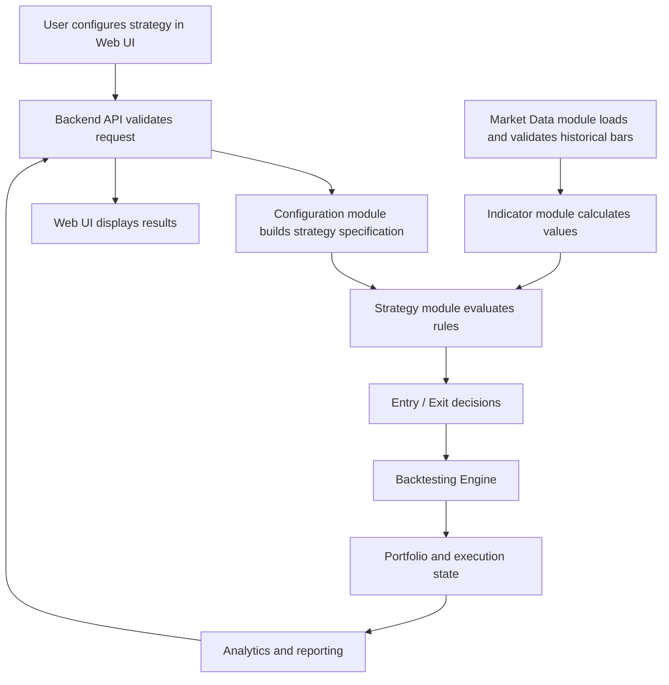

# TradeSim — Modular Development Roadmap

## Goal

Build TradeSim into a web-based strategy playground where users configure trading strategies from reusable components and backtest them against historical market data.

**Core design principle:** strategy logic is separate from the backtesting engine. Users configure strategies; the backend validates the configuration, assembles the required components, and runs them through a shared engine.

## 1. End-to-End Connection: How a Backtest Runs

The modules form a connected pipeline. A user's configuration travels into the backend, while market data flows through the strategy and engine. Results then flow back to the user.



**Important:** this is a logical flow, not necessarily a single synchronous call. Long backtests may run as background jobs later. The core engine should remain independent of the web framework.

## 2. Development Path — Build in This Order

### Phase 1 — Stabilize the Current Prototype

**Build:** finish the buy-and-hold benchmark and capture a known-good baseline.

**Connects to:** the current script and its existing data, strategy, execution, and accounting logic.

**Why first:** a baseline helps detect whether later refactoring accidentally changes behavior.

**Exit condition:** the current strategy and benchmark produce reproducible results with documented assumptions.

### Phase 2 — Market Data Module

**Build:** move CSV loading and validation into a dedicated module; define a consistent market-bar format.

**Receives:** a file path or, later, a data-source request.

**Provides:** validated, chronologically ordered OHLCV records to indicators and the engine.

**Connects to:** indicator calculations and backtest date-range selection. The strategy should not need to know how a CSV file was read.

**Exit condition:** data can be loaded and validated independently of strategy execution.

### Phase 3 — Indicator Module

**Build:** extract the existing SMA calculation into a reusable indicator component; later add EMA, RSI, MACD, Bollinger Bands, and others.

**Receives:** market data and indicator parameters, such as a period of 20.

**Provides:** a time-aligned series of indicator values.

**Connects to:** the strategy/rule layer. Indicators calculate values; they do not place trades or change cash.

**Exit condition:** indicators can be calculated and tested independently and reused by multiple strategies.

### Phase 4 — Rule and Condition Module

**Build:** reusable comparisons and events such as greater than, less than, crosses above, and crosses below; support AND/OR combinations.

**Receives:** price and indicator series.

**Provides:** Boolean conditions or events that can be evaluated at each time step.

**Connects to:** strategy entry and exit rules and, eventually, the visual strategy builder.

**Exit condition:** rules can be combined without writing a separate Python function for every combination.

### Phase 5 — Strategy Interface

**Build:** define a common contract for strategies, then adapt the current SMA crossover to it.

**Receives:** the market data and the indicator/rule outputs it needs.

**Provides:** strategy decisions, such as enter, exit, or do nothing, with a clearly defined signal timestamp.

**Connects to:** indicators/rules upstream and the backtesting engine downstream.

**Boundary:** the strategy decides *what it wants to do*; it does not directly deduct cash, apply fees, or modify the portfolio.

**Exit condition:** the SMA strategy runs through the interface without owning execution or accounting logic.

### Phase 6 — Backtesting and Execution Engine

**Build:** centralize order handling, execution timing, cash, positions, fees, slippage, and portfolio valuation.

**Receives:** strategy decisions plus market data and backtest settings.

**Provides:** executed trades, portfolio state over time, and an auditable trade ledger.

**Connects to:** the strategy through decisions; to market data through prices; to analytics through the resulting ledger and equity history.

**Exit condition:** multiple strategies can use the same engine without strategy-specific accounting code.

### Phase 7 — Analytics and Reporting

**Build:** calculate return, equity curve, drawdown, trade statistics, fees, and benchmark comparison.

**Receives:** portfolio history and trade ledger from the engine, plus benchmark data when needed.

**Provides:** a consistent results object.

**Connects to:** the API and web dashboard. It should report what happened, not change how trades were executed.

**Exit condition:** every strategy run returns comparable metrics and trade history.

### Phase 8 — Automated Tests and Reliability

**Build:** tests for data validation, indicators, signals, execution timing, fees, position sizing, accounting, and edge cases.

**Connects to:** every core module. Tests should be introduced as each module is built, not postponed until the end.

**Exit condition:** key expected behaviors are checked automatically and regressions are caught early.

### Phase 9 — Second Strategy Proof

**Build:** add a distinct strategy, such as RSI-based rules, through the same strategy interface.

**Connects to:** existing indicators/rules, the same execution engine, and the same analytics layer.

**Exit condition:** the second strategy works without copying or rewriting the engine. This is the practical test that the architecture is modular.

### Phase 10 — Strategy Configuration Module

**Build:** a structured representation of the user's selections: indicators, parameters, conditions, entry/exit rules, sizing, and execution assumptions.

**Receives:** validated user selections from the API.

**Provides:** a strategy specification that the strategy builder can interpret.

**Connects to:** the indicator registry, rule/condition components, strategy interface, and engine settings.

**Exit condition:** a supported strategy can be described as configuration rather than hand-written Python.

**Design choice:** start with declarative configuration and known components. Do not generate and execute arbitrary Python code for each request.

### Phase 11 — Backend API

**Build:** endpoints to list supported indicators/rules, validate strategy configurations, submit backtests, and retrieve results.

**Receives:** requests from the web frontend.

**Connects to:** configuration validation, market-data selection, backtest orchestration, and analytics.

**Provides:** structured responses and useful errors to the frontend. The API coordinates modules; it should not duplicate their business logic.

**Exit condition:** a client can request a supported backtest through a stable API.

### Phase 12 — Web Strategy Playground

**Build:** UI controls for market/data range, indicators, rules, entry/exit conditions, sizing, and execution settings.

**Connects to:** the backend API, not directly to Python modules or the database.

**Provides:** a validated configuration and displays the results returned by the API.

**Exit condition:** a user can create and run a supported strategy without editing code.

### Phase 13 — Saved Strategies and Experiment Management

**Build:** save configurations, retain run settings and results, and compare experiments.

**Connects to:** persistence/storage, the API, and the results dashboard.

**Exit condition:** users can reopen a strategy and understand exactly which configuration and assumptions produced a result.

### Phase 14 — Deployment and Operations

**Build:** packaging, environment configuration, logging, error reporting, resource limits, deployment, backups, and monitoring as appropriate.

**Connects to:** the entire application and its data stores.

**Exit condition:** the application can be deployed and operated reproducibly.

### Phase 15 — Advanced Capabilities (Later)

Possible extensions include parameter sweeps, optimization, more assets and timeframes, additional data providers, advanced portfolio models, and optional custom-code strategies.

These extend the existing architecture; they should not be prerequisites for the first usable release. Custom user code requires strong isolation and resource limits.

## 3. Target Module Structure

```text
TradeSim/
├── data/                       # Local historical datasets
├── src/
│   └── tradesim/
│       ├── data/               # Loading, validation, market-data interface
│       ├── indicators/         # SMA, EMA, RSI, MACD, and others
│       ├── rules/              # Conditions and logical combinations
│       ├── strategies/         # Strategy interface and implementations
│       ├── engine/             # Orders, execution, portfolio, fees
│       ├── analytics/          # Metrics, trade history, benchmarks
│       ├── config/             # Strategy specification and validation
│       └── api/                # Backend API and orchestration
├── tests/                      # Tests for all core modules
├── web/                        # Frontend
├── README.md
└── pyproject.toml
```

This is a target layout, not a requirement to create every folder immediately. Extract responsibilities incrementally and keep the application runnable after each change.

## 4. Responsibilities and Boundaries

| Module | Owns | Must not own |
|---|---|---|
| Data | Reading, validating, and supplying market bars | Trading decisions |
| Indicators | Calculating indicator values | Orders or portfolio state |
| Rules | Evaluating conditions | Cash and execution |
| Strategy | Entry/exit decisions | Applying fills or fees |
| Engine | Orders, fills, fees, cash, positions, equity | Defining a specific strategy |
| Analytics | Metrics and reports | Changing backtest state |
| Configuration | Validating and describing selected components | Executing arbitrary user code |
| API | Coordinating requests and responses | Reimplementing engine logic |
| Web UI | Collecting choices and presenting results | Running trading calculations itself |

## 5. Development Rules

1. Build one module at a time.
2. Define each module's inputs, outputs, and responsibility before coding.
3. Test each module as it is introduced.
4. Keep signal time separate from execution time to avoid look-ahead bias.
5. Keep strategy decisions separate from execution and accounting.
6. Use the same engine and result format for all strategies.
7. Start with supported configuration choices, not unrestricted code execution.
8. Keep the first release focused on historical backtesting; live trading is out of scope.
9. Validate the product with prospective users before expanding features.

## 6. Immediate Next Steps

1. Complete the buy-and-hold benchmark.
2. Capture a known-good baseline.
3. Extract market-data loading and validation into its own module.
4. Add tests around that module.
5. Extract the SMA calculation and test it.
6. Continue one boundary at a time, keeping behavior reproducible.

## 7. Definition of a Successful Modular Architecture

The architecture is working when you can add a new strategy by implementing its decision logic and configuration, then run it through the existing engine and analytics—without duplicating cash accounting, fee handling, or reporting.
